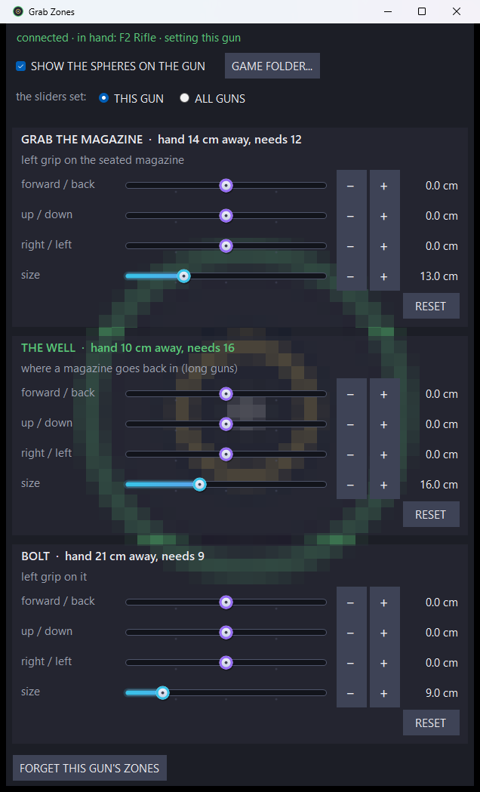

# Grab Zones: move and resize Visceral RE8's grab zones from a desktop window

A small desktop window for Visceral RE8 (Resident Evil Village VR). Every place the left hand can take hold of a gun is a zone:
grabbing the magazine, the well where a magazine goes back in, and the slide, pump or bolt. Each zone has sliders: forward /
back, up / down, right / left, and its size. Move one and the zone moves on the gun in the game at once, together with its sphere
when "SHOW THE SPHERES ON THE GUN" is ticked. The − and + buttons step half a centimetre, easier than dragging with a VR pointer.

Each zone's title says live how far the hand is from it and how close it needs to be, and turns green when the hand is inside.
**THIS GUN** sets the gun in hand only; **ALL GUNS** sets the default every gun uses unless it has its own. **RESET** gives a
zone back to the mod's own numbers; **FORGET THIS GUN'S ZONES** (click twice) does that for the whole gun.

Made 2026-10-25 for tuning the zones inside the headset: Window View hangs this window in VR, the same way as Hand Poser.
The same sliders are in the game's REFramework menu under "Visceral RE8 grab zones".

## Build and install

`build.bat` (only the C# compiler that ships with Windows), then `dist\GrabZones.exe --selftest build\selftest` (no game
needed), then `install.ps1` for the desktop icon. The game half ships with Visceral RE8 (`..\tools\build.sh --deploy`).

## How it works

- The window writes `reframework\data\visceral_re8\zones.json` in the game folder: per gun ("3042") over "default", each
  zone's offset from its joint in the gun's axes (metres) and its radius (metres), plus `_visual.show` for the spheres.
- The plugin (`..\src\zones.cpp`) re-reads that file within a third of a second of any change and tests the hand against it.
- The in-game script (`..\lua\visceral_re8_zones.lua`) draws the spheres and writes `zones_state.json` four times a second:
  the gun in hand and, per zone, its size and how far the hand is from it. The window reads that for its live lines.

`app\Json.cs` is copied from [Hand Poser](https://github.com/TefMeister/hand-poser-vr).
